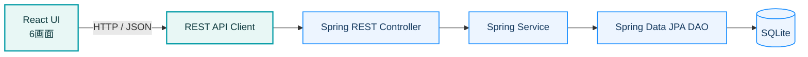
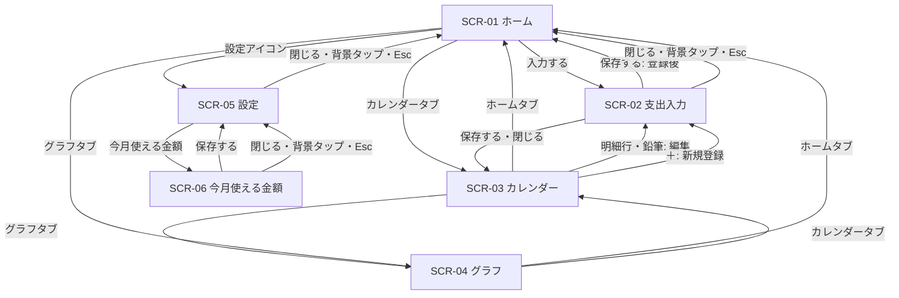
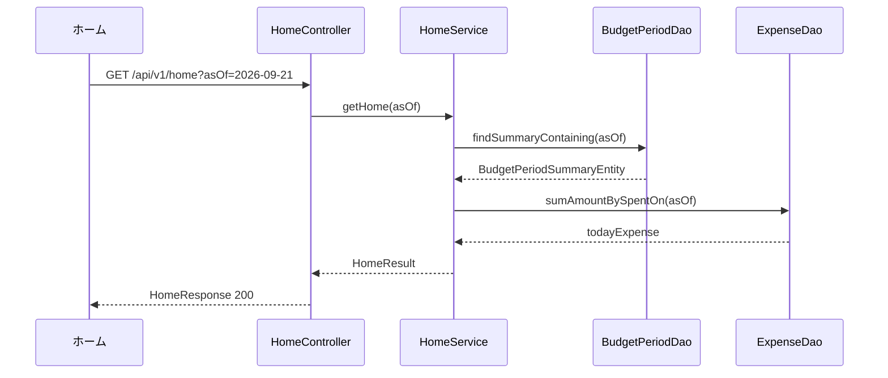
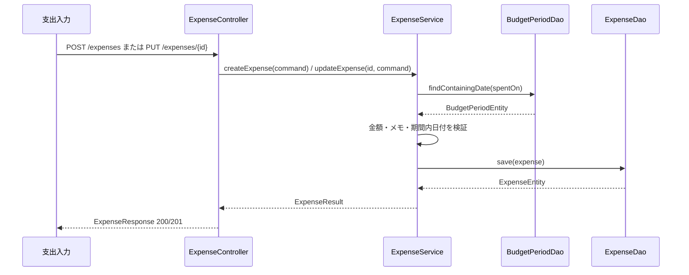
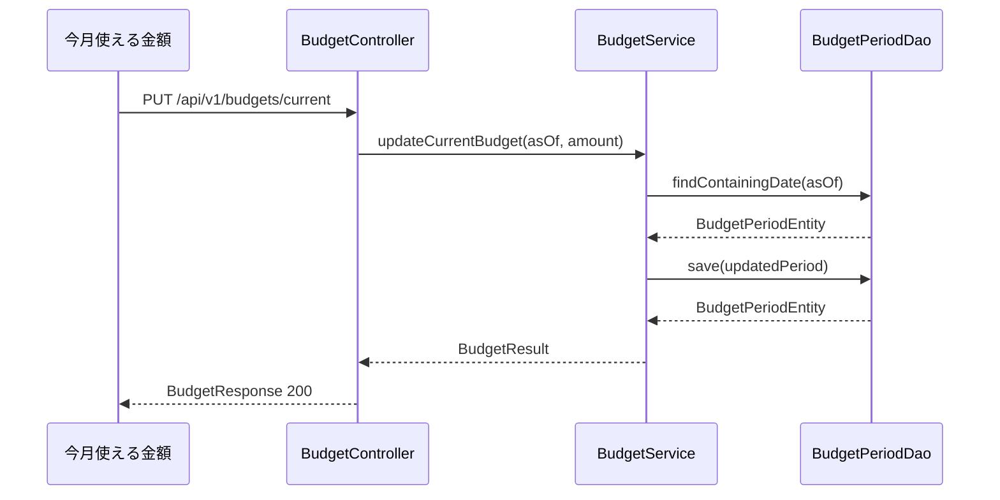
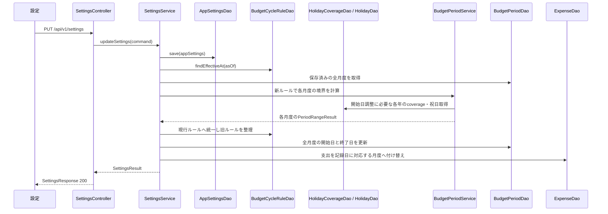
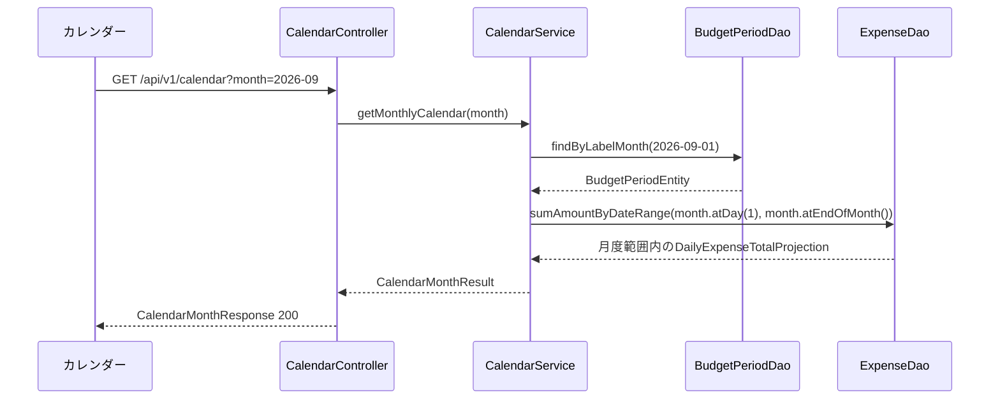
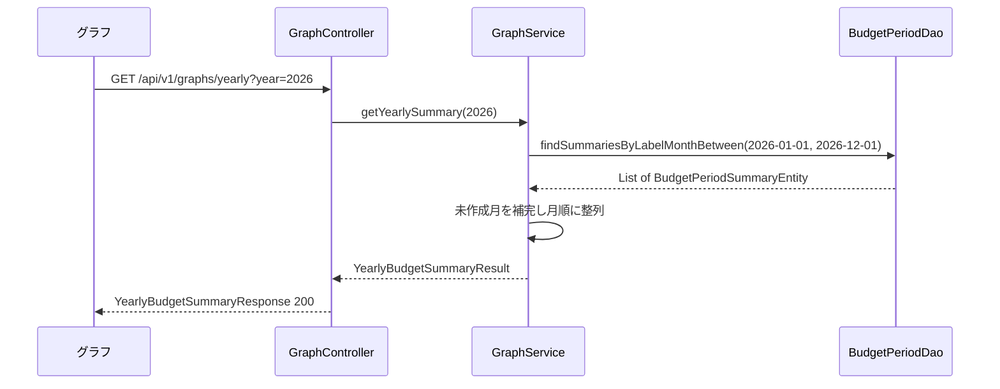

# ズボラ家計簿 プログラム機能構成図

## 1. 目的

本書は、現行の画面モックを実データへ接続するときの機能構成を、画面操作からデータベースまで一続きで追跡できるように定義します。

- 今回の開発は、ReactクライアントからSpring Boot REST APIを呼び出し、SQLiteへ保存します。
- Spring BootはController、Service、Spring Data JPA DAOのレイヤーで構成します。
- PostgreSQL、クラウド同期、課金は今回の開発対象に含めません。
- クラス名、メソッド名、DTO名は英語、画面名と説明は日本語で表記します。

> Spring Boot側のController／Service／DAOとSQLite接続、およびReactからのREST API接続を実装済みです。API契約の詳細は[API設計書](API_DESIGN.md)を参照してください。

## 2. 対象画面

| ID | 画面 | 役割 |
| --- | --- | --- |
| SCR-01 | ホーム | 今月の残り予算、今日の支出、残り日数を確認する起点画面 |
| SCR-02 | 支出入力ボトムシート | 金額必須、メモ任意で支出を登録・編集する操作画面 |
| SCR-03 | カレンダー | 日別支出合計と選択日の明細を確認する画面 |
| SCR-04 | グラフ | 年内の月別残額を確認する画面 |
| SCR-05 | 設定ボトムシート | 通知、月度の開始日、土日祝による終了日の自動調整を設定する画面 |
| SCR-06 | 今月使える金額ボトムシート | 進行中期間の予算額を変更する画面 |

カレンダーの日別明細は `SCR-03` 内の表示領域として扱い、独立画面にはしません。支出入力、設定、今月使える金額は画面上に重なるボトムシートですが、入出力と遷移を持つため独立した操作画面として扱います。

## 3. システム全体構成

### 3.1 今回の技術境界

| 層 | 技術 | 責務 |
| --- | --- | --- |
| UI | React・TypeScript | 画面状態、入力、APIレスポンスの表示 |
| API Client | TypeScript | HTTPリクエスト、レスポンスDTOの受け取り |
| Controller | Spring Boot | HTTP、Bean Validation、DTO変換 |
| Service | Spring Boot | 期間計算、入力検証、トランザクション |
| DAO | Spring Data JPA | SQLiteに対する永続化と検索 |
| Database | SQLite | アプリデータの保存 |
| アカウント | なし | 認証導入時に別途追加 |

## 4. 画面遷移図

## 5. 画面機能一覧

API欄は今回のSpring Boot開発環境で使用するエンドポイントです。画面はREST API Clientを通じて呼び出します。

| 遷移前画面 | ボタン／リンク | 遷移後画面 | 画面への入力 | 画面の出力 | 使用API |
| --- | --- | --- | --- | --- | --- |
| アプリ起動 | 初期表示 | ホームまたは初期予算入力 | 基準日 | 初期設定状態、設定済みならホーム情報 | `GET /api/v1/setup`、`GET /api/v1/home?asOf=YYYY-MM-DD`、`GET /api/v1/settings` |
| 初期予算入力 | 保存する | ホーム | 予算額 | 初期設定・現在月度・ホーム情報 | `POST /api/v1/setup`、`GET /api/v1/home`、`GET /api/v1/settings` |
| ホーム | 入力する | 支出入力 | 初期金額0、当日、空メモ、登録モード | 金額、メモ、保存可否 | 画面表示時はAPIなし |
| 支出入力 | 保存する | ホーム | 利用日、金額、任意メモ | 登録した支出、再取得したホーム情報 | `POST /api/v1/expenses`、`GET /api/v1/home` |
| ホーム／カレンダー／グラフ | ホームタブ | ホーム | 基準日 | ホーム情報 | `GET /api/v1/home` |
| ホーム／カレンダー／グラフ | カレンダータブ | カレンダー | 対象月度 | 月度の開始日〜終了日の全日付と日別支出合計 | `GET /api/v1/calendar?month=YYYY-MM` |
| カレンダー | 前月度／翌月度 | カレンダー | 対象月度 | 切替後の月度範囲とその期間内の日別支出合計 | `GET /api/v1/calendar?month=YYYY-MM` |
| カレンダー | 対象期間内の日付 | カレンダー内の日別明細 | 選択日 | 当日の支出合計、支出明細 | `GET /api/v1/calendar/days/{date}` |
| カレンダー | ＋ | 支出入力 | 選択日、初期金額0、空メモ、登録モード | 金額、メモ、保存可否 | 画面表示時はAPIなし |
| カレンダー | 明細行／鉛筆 | 支出入力 | 支出ID、既存金額、既存メモ、利用日、編集モード | 編集対象の金額とメモ | 既に取得した明細を使用 |
| 支出入力 | 保存する（編集） | カレンダー | 支出ID、利用日、金額、任意メモ | 更新した支出、更新後の日別合計 | `PUT /api/v1/expenses/{expenseId}` |
| ホーム／カレンダー／グラフ | グラフタブ | グラフ | 表示年 | 月別予算、支出合計、残り金額 | `GET /api/v1/graphs/yearly?year=YYYY` |
| グラフ | 年選択ボタン／年選択シート | グラフ | 選択年 | 切替後の月別集計 | `GET /api/v1/graphs/yearly?year=YYYY` |
| グラフ | 月の棒 | グラフ | 対象月 | 選択線と対象月表示 | 追加APIなし |
| ホーム | 設定アイコン | 設定 | なし | 通知、月度の開始日、土日祝調整、今月度・次月度の範囲、現在予算 | `GET /api/v1/settings` |
| 設定 | 通知／期間の各入力 | 設定 | 通知ON/OFF、月度の開始日、土日祝調整 | 更新後設定、今月度・次月度の実際の範囲 | `PUT /api/v1/settings` |
| 設定 | 今月使える金額 | 今月使える金額 | 現在の予算額 | 編集中の予算額 | 既に取得した設定を使用 |
| 今月使える金額 | 保存する | 設定 | 基準日、予算額 | 更新後の予算期間 | `PUT /api/v1/budgets/current` |
| 各ボトムシート | 閉じる／背景タップ／Esc | 遷移元画面 | 編集途中の値 | 保存せず破棄 | APIなし |

## 6. Spring Boot REST API機能構成

### 6.1 API一覧

| 機能ID | HTTP | パス | Request | Response | Controller |
| --- | --- | --- | --- | --- | --- |
| FN-00a | GET | `/api/v1/setup` | なし | `SetupStatusResponse` | `SetupController` |
| FN-00b | POST | `/api/v1/setup` | `SetupRequest` | `SettingsResponse` | `SetupController` |
| FN-01 | GET | `/api/v1/home?asOf={date}` | `LocalDate asOf` | `HomeResponse` | `HomeController` |
| FN-02 | POST | `/api/v1/expenses` | `CreateExpenseRequest` | `ExpenseResponse` | `ExpenseController` |
| FN-03 | PUT | `/api/v1/expenses/{expenseId}` | `UUID expenseId`, `UpdateExpenseRequest` | `ExpenseResponse` | `ExpenseController` |
| FN-04 | GET | `/api/v1/calendar?month={yearMonth}` | `YearMonth month` | `CalendarMonthResponse` | `CalendarController` |
| FN-05 | GET | `/api/v1/calendar/days/{date}` | `LocalDate date` | `DailyExpensesResponse` | `CalendarController` |
| FN-06 | GET | `/api/v1/graphs/yearly?year={year}` | `int year` | `YearlyBudgetSummaryResponse` | `GraphController` |
| FN-07 | GET | `/api/v1/settings` | なし | `SettingsResponse` | `SettingsController` |
| FN-08 | PUT | `/api/v1/settings` | `UpdateSettingsRequest` | `SettingsResponse` | `SettingsController` |
| FN-09 | PUT | `/api/v1/budgets/current` | `UpdateBudgetRequest` | `BudgetResponse` | `BudgetController` |
| FN-10 | GET | `/api/v1/budgets/current?asOf={date}` | `LocalDate asOf` | `BudgetResponse` | `BudgetController` |

### 6.2 Controller／Service／DAO／テーブル対応

| 機能ID | Controllerメソッド（引数）／出力 | Serviceメソッド（引数）／出力 | DAOメソッド（引数）／出力 | テーブル／ビュー |
| --- | --- | --- | --- | --- |
| FN-00a | `SetupController.getStatus(): SetupStatusResponse` | `SetupService.isInitialized(): boolean` | `AppSettingsDao.existsById(Short id): boolean` | `app_settings` |
| FN-00b | `SetupController.setup(SetupRequest request): SettingsResponse` | `SetupService.setup(long budgetAmount): SettingsResult` | `AppSettingsDao.existsById(Short id): boolean` `AppSettingsDao.save(AppSettingsEntity entity): AppSettingsEntity` `BudgetCycleRuleDao.count(): long` `BudgetCycleRuleDao.save(BudgetCycleRuleEntity entity): BudgetCycleRuleEntity` `BudgetPeriodDao.count(): long` `BudgetPeriodDao.save(BudgetPeriodEntity entity): BudgetPeriodEntity` | `app_settings`、`budget_cycle_rules`、`budget_periods` |
| FN-01 | `HomeController.getHome(LocalDate asOf): HomeResponse` | `HomeService.getHome(LocalDate asOf): HomeResult` | `BudgetPeriodDao.findSummaryContaining(LocalDate date): Optional<BudgetPeriodSummaryEntity>` `ExpenseDao.sumAmountBySpentOn(LocalDate date): long` | `budget_periods`、`expenses`、`budget_period_summary` |
| FN-02 | `ExpenseController.createExpense(CreateExpenseRequest request): ExpenseResponse` | `ExpenseService.createExpense(CreateExpenseCommand command): ExpenseResult` | `BudgetPeriodDao.findContainingDate(LocalDate date): Optional<BudgetPeriodEntity>` `ExpenseDao.save(ExpenseEntity entity): ExpenseEntity` | `budget_periods`、`expenses` |
| FN-03 | `ExpenseController.updateExpense(UUID expenseId, UpdateExpenseRequest request): ExpenseResponse` | `ExpenseService.updateExpense(UUID expenseId, UpdateExpenseCommand command): ExpenseResult` | `ExpenseDao.findById(UUID id): Optional<ExpenseEntity>` `BudgetPeriodDao.findContainingDate(LocalDate date): Optional<BudgetPeriodEntity>` `ExpenseDao.save(ExpenseEntity entity): ExpenseEntity` | `expenses`、`budget_periods` |
| FN-04 | `CalendarController.getMonthlyCalendar(YearMonth month): CalendarMonthResponse` | `CalendarService.getMonthlyCalendar(YearMonth month): CalendarMonthResult` | `BudgetPeriodDao.findByLabelMonth(LocalDate labelMonth): Optional<BudgetPeriodEntity>` `ExpenseDao.sumAmountByDateRange(LocalDate from, LocalDate to): List<DailyExpenseTotalProjection>` | `budget_periods`、`expenses` |
| FN-05 | `CalendarController.getDailyExpenses(LocalDate date): DailyExpensesResponse` | `CalendarService.getDailyExpenses(LocalDate date): DailyExpensesResult` | `ExpenseDao.findAllBySpentOnOrderByCreatedAtAsc(LocalDate date): List<ExpenseEntity>` | `expenses` |
| FN-06 | `GraphController.getYearlySummary(int year): YearlyBudgetSummaryResponse` | `GraphService.getYearlySummary(int year): YearlyBudgetSummaryResult` | `BudgetPeriodDao.findSummariesByLabelMonthBetween(LocalDate from, LocalDate to): List<BudgetPeriodSummaryEntity>` `BudgetPeriodDao.findDistinctLabelYears(): List<Integer>` | `budget_periods`、`expenses`、`budget_period_summary` |
| FN-07 | `SettingsController.getSettings(): SettingsResponse` | `SettingsService.getSettings(LocalDate asOf): SettingsResult` | `AppSettingsDao.findById(Short id): Optional<AppSettingsEntity>` `BudgetCycleRuleDao.findEffectiveAt(LocalDate date): Optional<BudgetCycleRuleEntity>` `BudgetCycleRuleDao.findById(UUID id): Optional<BudgetCycleRuleEntity>` `BudgetPeriodDao.findContainingDate(LocalDate date): Optional<BudgetPeriodEntity>` `BudgetPeriodDao.findByLabelMonth(LocalDate labelMonth): Optional<BudgetPeriodEntity>` `HolidayCoverageDao.existsById(Short year): boolean` `HolidayDao.existsById(String holidayDate): boolean`（次月度が未作成で調整ONのプレビュー時） | `app_settings`、`budget_cycle_rules`、`budget_periods`、`holiday_calendar_coverage`、`holidays` |
| FN-08 | `SettingsController.updateSettings(UpdateSettingsRequest request): SettingsResponse` | `SettingsService.updateSettings(UpdateSettingsCommand command): SettingsResult` `BudgetPeriodService.calculatePeriod(YearMonth, BudgetCycleRuleEntity): PeriodRangeResult` | `AppSettingsDao`で通知を更新。`BudgetCycleRuleDao`・`BudgetPeriodDao`で対象と前後の月度を取得し、同一トランザクション内のSQLでルール・期間・支出の所属月度を更新。`HolidayCoverageDao`・`HolidayDao`で調整に必要な祝日を確認 | `app_settings`、`budget_cycle_rules`、`budget_periods`、`expenses`、`holiday_calendar_coverage`、`holidays` |
| FN-09 | `BudgetController.updateCurrentBudget(UpdateBudgetRequest request): BudgetResponse` | `BudgetService.updateCurrentBudget(LocalDate asOf, long amount): BudgetResult` | `BudgetPeriodDao.findContainingDate(LocalDate date): Optional<BudgetPeriodEntity>` `BudgetPeriodDao.save(BudgetPeriodEntity entity): BudgetPeriodEntity` | `budget_periods` |
| FN-10 | `BudgetController.getCurrentBudget(LocalDate asOf): BudgetResponse` | `BudgetService.getCurrentBudget(LocalDate asOf): BudgetResult` | `BudgetPeriodDao.findContainingDate(LocalDate date): Optional<BudgetPeriodEntity>` `BudgetPeriodDao.findSummaryContaining(LocalDate date): Optional<BudgetPeriodSummaryEntity>` | `budget_periods`、`expenses`、`budget_period_summary` |

### 6.3 Controllerクラス

| クラス | 責務 | メソッド |
| --- | --- | --- |
| `SetupController` | 初回利用状態の取得と初期予算登録 | `getStatus(): SetupStatusResponse` `setup(SetupRequest request): SettingsResponse` |
| `HomeController` | ホーム表示用の集約結果をHTTPレスポンスへ変換 | `getHome(LocalDate asOf): HomeResponse` |
| `ExpenseController` | 支出登録・編集リクエストの検証とDTO変換 | `createExpense(CreateExpenseRequest request): ExpenseResponse` `updateExpense(UUID expenseId, UpdateExpenseRequest request): ExpenseResponse` |
| `CalendarController` | 月別カレンダーと日別明細の取得 | `getMonthlyCalendar(YearMonth month): CalendarMonthResponse` `getDailyExpenses(LocalDate date): DailyExpensesResponse` |
| `GraphController` | 年別の月次集計取得 | `getYearlySummary(int year): YearlyBudgetSummaryResponse` |
| `SettingsController` | 設定の取得と現在月度からの設定更新 | `getSettings(): SettingsResponse` `updateSettings(UpdateSettingsRequest request): SettingsResponse` |
| `BudgetController` | 進行中期間の予算額取得・更新 | `getCurrentBudget(LocalDate asOf): BudgetResponse` `updateCurrentBudget(UpdateBudgetRequest request): BudgetResponse` |

ControllerはHTTP、Bean Validation、DTO変換だけを担当し、DBアクセスや期間計算を行いません。基準日をリクエストに持たない設定取得では、Controllerが `Clock` から `Asia/Tokyo` の当日を求めてServiceへ渡します。

### 6.4 Serviceクラス

| クラス | メソッド（引数）／出力 | 主な処理 | トランザクション |
| --- | --- | --- | --- |
| `SetupService` | `isInitialized(): boolean` `setup(long budgetAmount): SettingsResult` | 空DBに設定・開始日1日のルール・当月の予算期間を作成 | 登録時必須 |
| `HomeService` | `getHome(LocalDate asOf): HomeResult` | 未作成月度を必要時に作成し、対象期間、残額、当日支出、残り日数を集約 | 月度作成を含む |
| `ExpenseService` | `createExpense(CreateExpenseCommand command): ExpenseResult` `updateExpense(UUID expenseId, UpdateExpenseCommand command): ExpenseResult` | 金額・メモ・期間内日付を検証し、支出を登録・更新 | 必須 |
| `CalendarService` | `getMonthlyCalendar(YearMonth month): CalendarMonthResult` `getDailyExpenses(LocalDate date): DailyExpensesResult` | 未作成月度を必要時に作成し、対象月度の開始日〜終了日の日別合計と、選択日の明細を取得 | 月度作成を含む |
| `GraphService` | `getYearlySummary(int year): YearlyBudgetSummaryResult` | 1月から12月までの予算・支出・残額を整列し、年選択シート用に記録のある年を返す | 読み取り専用 |
| `SettingsService` | `getSettings(LocalDate asOf): SettingsResult` `updateSettings(UpdateSettingsCommand command): SettingsResult` | 通知更新。開始日・土日祝調整の変更時は保存済みの全月度を単一の現行ルールで組み直し、支出の所属月度を記録日で更新。期間計算は`BudgetPeriodService`へ委譲 | 更新時必須 |
| `BudgetPeriodService` | `calculatePeriod(YearMonth labelMonth, BudgetCycleRuleEntity rule): PeriodRangeResult` | 月末丸めと土日祝前倒しから期間境界を計算し、祝日coverageを検証 | 読み取り専用の計算 |
| `PeriodProvisioningService` | `ensureDate(LocalDate date): BudgetPeriodEntity` `ensureMonth(YearMonth month): BudgetPeriodEntity` | 表示・記録に必要な未作成月度を現行規則と予算0円で作成 | 必須 |
| `BudgetService` | `getCurrentBudget(LocalDate asOf): BudgetResult` `updateCurrentBudget(LocalDate asOf, long amount): BudgetResult` | 進行中期間の予算額・残額を取得し、予算額を即時更新 | 更新時必須 |

### 6.5 DAOクラス

DAOはSpring Data JPAのRepositoryインターフェースとして定義します。`save` と `findById` は `JpaRepository` の標準メソッドを使用し、日付範囲・集計検索はSQLite向けのJPQLまたはnative queryで定義します。

| DAO | メソッド（引数）／出力 | 対象 |
| --- | --- | --- |
| `AppSettingsDao` | `findById(Short id): Optional<AppSettingsEntity>` `save(AppSettingsEntity entity): AppSettingsEntity` | `app_settings` |
| `BudgetCycleRuleDao` | `findEffectiveAt(LocalDate date): Optional<BudgetCycleRuleEntity>` `findOverlapping(LocalDate from, LocalDate to): List<BudgetCycleRuleEntity>` `save(BudgetCycleRuleEntity entity): BudgetCycleRuleEntity` | `budget_cycle_rules` |
| `BudgetPeriodDao` | `findContainingDate(LocalDate date): Optional<BudgetPeriodEntity>` `findByLabelMonth(LocalDate labelMonth): Optional<BudgetPeriodEntity>` `findOverlappingDateRange(LocalDate from, LocalDate to): List<BudgetPeriodEntity>` `findSummaryContaining(LocalDate date): Optional<BudgetPeriodSummaryEntity>` `findSummariesByLabelMonthBetween(LocalDate from, LocalDate to): List<BudgetPeriodSummaryEntity>` `findDistinctLabelYears(): List<Integer>` `save(BudgetPeriodEntity entity): BudgetPeriodEntity` | `budget_periods`、`budget_period_summary` |
| `ExpenseDao` | `findById(UUID id): Optional<ExpenseEntity>` `findAllBySpentOnOrderByCreatedAtAsc(LocalDate date): List<ExpenseEntity>` `existsByBudgetPeriodIdAndSpentOnAfter(UUID budgetPeriodId, LocalDate date): boolean` `sumAmountBySpentOn(LocalDate date): long` `sumAmountByDateRange(LocalDate from, LocalDate to): List<DailyExpenseTotalProjection>` `save(ExpenseEntity entity): ExpenseEntity` | `expenses` |
| `HolidayCoverageDao` | `existsById(Short calendarYear): boolean` | `holiday_calendar_coverage` |
| `HolidayDao` | `existsById(String holidayDate): boolean` `findAllByCalendarYearOrderByHolidayDateAsc(Short calendarYear): List<HolidayEntity>` | `holidays` |

FN-04の `sumAmountByDateRange` には対象月度の `periodStart` と `periodEnd` を渡します。カレンダーのマスもその範囲を表示し、翌暦月にまたがる日付を同じ月度内で確認・入力・編集できるようにします。

FN-08で開始日または土日祝調整を変更した場合は、保存済みの過去・現在・将来すべての月度を同じ規則で再計算します。支出は記録日を維持して新しい月度へ付け替え、月度別予算は保持します。未作成月度は表示・記録時に予算0円で作成します。通知だけの変更では期間を作り直しません。画面の「月度の範囲」はAPIレスポンスの実際の境界を表示し、React内では再計算しません。

設定取得の開始日・土日祝調整には単一の現行ルールの値を返します。同じ値で通知だけを変更しても期間を再作成しません。開始日・土日祝調整を再変更した場合も保存済み全月度を再計算し、既存支出を記録日により付け替えます。

## 7. 入出力DTO

### 7.1 Request

| DTO | フィールド | 制約 |
| --- | --- | --- |
| `CreateExpenseRequest` | `LocalDate spentOn`、`Long amount`、`String memo` | 日付・金額必須。金額1〜999,999,999、メモNULLまたは120文字以内 |
| `UpdateExpenseRequest` | `LocalDate spentOn`、`Long amount`、`String memo` | 登録時と同じ。空文字メモはServiceでNULLへ正規化 |
| `UpdateSettingsRequest` | `Boolean monthlyNotificationEnabled`、`Integer startDay`、`Boolean adjustForWeekendsAndHolidays` | 全項目必須。開始日は1〜31。存在しない日付は月末へ丸め、土日祝調整ONなら開始日を直前の平日へ調整。終了日は次月度の調整済み開始日の前日 |
| `UpdateBudgetRequest` | `LocalDate asOf`、`Long amount` | 全項目必須。金額1〜999,999,999。GETの`asOf`はクエリ引数で指定 |

Serviceへ渡すCommandはHTTP Requestの検証後に生成します。

| DTO | フィールド |
| --- | --- |
| `CreateExpenseCommand`／`UpdateExpenseCommand` | `LocalDate spentOn`、`long amount`、`String memo` |
| `UpdateSettingsCommand` | `boolean monthlyNotificationEnabled`、`int startDay`、`boolean adjustForWeekendsAndHolidays` |

### 7.2 Response／Service Result

| DTO | 主なフィールド |
| --- | --- |
| `HomeResponse`／`HomeResult` | `labelMonth`、`budgetAmount`、`spentAmount`、`remainingAmount`、`todayExpense`、`remainingDays`、`message` |
| `ExpenseResponse`／`ExpenseResult` | `id`、`budgetPeriodId`、`spentOn`、`amount`、`memo`、`createdAt`、`updatedAt` |
| `CalendarMonthResponse`／`CalendarMonthResult` | `YearMonth month`（月度ラベル）、`periodStart`、`periodEnd`、`List<DailyExpenseTotal> dailyTotals`（月度の開始日〜終了日を対象に集計） |
| `DailyExpensesResponse`／`DailyExpensesResult` | `date`、`totalAmount`、`List<ExpenseResponse> expenses` |
| `YearlyBudgetSummaryResponse`／`YearlyBudgetSummaryResult` | `year`、`availableYears`（月度データが存在する年のみ）、`List<MonthlyBudgetSummary> monthlySummaries` |
| `SettingsResponse`／`SettingsResult` | `monthlyNotificationEnabled`、`timezone`、`startDay`、`adjustForWeekendsAndHolidays`、`currentBudgetAmount`、`currentPeriodRange`（当月度）、`nextPeriodRange`（次月度）。各`PeriodRangeResponse`は`labelMonth`、`startDate`、`endDate`を持つ |
| `BudgetResponse`／`BudgetResult` | `budgetPeriodId`、`labelMonth`、`budgetAmount`、`remainingAmount`、`updatedAt` |

各Service Resultは対応するHTTP Responseと同じ値を保持し、ControllerがResponse DTOへ変換します。`PeriodRangeResult`は`labelMonth`、`startDate`、`nominalEndDate`、`endDate`を持ち、期間計算ServiceとSettingsのService Resultで使います。

`DailyExpenseTotal` は `date` と `totalAmount` を持ちます。`MonthlyBudgetSummary` は `month`（1〜12）、`budgetAmount`、`spentAmount`、`remainingAmount`、`expenseCount` を持ちます。データがない月はServiceが0件の月として補完し、1月から12月の順で返します。

共通の `ErrorResponse` は `code`、`message`、`fieldErrors`（フィールド名と検証メッセージのMap）、`timestamp` を持ちます。Requestの金額は未指定を検出できるよう `Long` とし、ControllerでBean Validationを適用します。

## 8. 代表データフロー

### 8.1 ホーム表示

### 8.2 支出登録・編集

### 8.3 予算更新

### 8.4 設定更新

### 8.5 カレンダー表示

### 8.6 グラフ表示

## 9. テーブル対応

| テーブル／ビュー | 主な保持内容 | 更新する機能 | 参照する機能 |
| --- | --- | --- | --- |
| `app_settings` | 月初通知、タイムゾーン | FN-08 | FN-07 |
| `budget_cycle_rules` | 月度の開始日、土日祝調整、適用履歴 | FN-08 | FN-04、FN-07、FN-08 |
| `budget_periods` | 月度の開始日、予定終了日、実際の終了日、予算額 | FN-08（保存済み全月度の境界更新）、FN-09 | FN-01〜FN-04、FN-06〜FN-09 |
| `expenses` | 利用日、金額、任意メモ | FN-02、FN-03 | FN-01、FN-04〜FN-06、FN-08（境界変更時の既存支出確認） |
| `holiday_calendar_coverage` | 年単位の祝日データ完全性 | 祝日取込処理（本書の画面外） | FN-08、期間生成処理 |
| `holidays` | 日本の祝日の日付、名称、出典 | 祝日取込処理（本書の画面外） | FN-08、期間生成処理 |
| `budget_period_summary` | 予算額、支出合計、残額、件数 | ビューのため直接更新しない | FN-01、FN-06 |

## 10. 入力検証・トランザクション・エラー

### 10.1 入力検証

- 金額は日本円の整数で、`1`〜`999,999,999` とします。
- メモは任意で120文字以内、空文字はServiceでNULLへ正規化します。
- 支出日は所属する予算期間の開始日以上、実際の終了日以下とします。
- 月度の開始日は1〜31とし、存在しない日付は月末へ丸めます。土日祝調整ONでは開始日を直前の平日へ調整し、終了日は次月度の調整済み開始日の前日として月度を連続させます。
- 土日祝調整がONの場合、当月度と次月度の開始予定日を直前の平日へ戻す過程で参照する各年の `holiday_calendar_coverage` が必要です。年境界をまたいで前倒しする場合は前年のcoverageも確認し、不足時は期間を生成しません。
- 新しい予算期間・ルールの有効期間が既存データと重複する場合は拒否します。
- 開始日の変更で月度境界をまたぐ支出は、記録日を変えずに対応する月度へ付け替えます。予算額は各月度に維持し、残額などの算出値を再集計します。
- 予算超過による負の残額は正常値として許可します。未設定月度の予算額は0で、前月度から金額を引き継ぎません。グラフでは未設定月度の表示額を0円とします。

### 10.2 トランザクション境界

- `ExpenseService.createExpense` と `updateExpense` は、期間確認と支出保存を同一トランザクションで行います。
- `SettingsService.updateSettings` は、設定更新、現行ルールへの統一、保存済み全月度の境界更新、支出の所属月度変更を同一トランザクションで行います。期間計算は `BudgetPeriodService` を使用します。
- `BudgetService.updateCurrentBudget` は、進行中期間の取得と予算更新を同一トランザクションで行います。
- 取得系Serviceは `readOnly = true` とします。

### 10.3 HTTPエラー

| HTTP | 用途 | 例 |
| --- | --- | --- |
| `400 Bad Request` | 形式・Bean Validation不正 | 金額0、メモ121文字、存在しない日付、開始日32 |
| `404 Not Found` | 対象データが存在しない | 支出ID不明、対象日に予算期間がない |
| `409 Conflict` | 既存状態との競合 | 予算期間またはルールの有効期間が重複 |
| `422 Unprocessable Entity` | 形式は正しいが業務条件を満たさない | 支出日が期間外、祝日カバレッジ不足、調整後の終了日が開始日前 |
| `500 Internal Server Error` | 想定外の処理失敗 | DB接続障害など |

エラーレスポンスは `ErrorResponse { code, message, fieldErrors, timestamp }` に統一します。ユーザー向けメッセージは責める表現を避け、画面で再入力できる内容にします。

## 11. SQLite実装方針

今回の開発で使用するDBはSQLiteのみです。Spring BootのDAOはSQLiteに接続し、画面はすべてSpring Boot REST APIを経由します。

| 項目 | 方針 |
| --- | --- |
| JDBC | SQLite JDBCドライバーを使用する |
| ORM | Spring Data JPA。SQLite対応Dialectを明示設定する |
| スキーマ変更 | Flywayのバージョン付きSQL／Javaマイグレーションを使用する |
| 外部キー | 接続開始時に `PRAGMA foreign_keys = ON` を有効にする |
| UUID | Javaアプリケーション側で生成し、SQLiteの`TEXT`列へ保存する |
| 日付・日時 | 日付は`YYYY-MM-DD`、日時はUTC ISO 8601文字列としてSQLiteへ保存する |
| 金額 | SQLiteの64bit `INTEGER`。日本円の正の整数として扱う |
| マイグレーション管理 | Spring Boot実行時はFlywayの `flyway_schema_history` を正とする。既存SQLiteの `PRAGMA user_version` は初回引き継ぎ判定にだけ使用する。開始日1〜31日の初期スキーマはFlyway V1、月度ごとの0円初期化はV2で適用する。モバイル版も同等のV2を適用する |

PostgreSQL接続、クラウド同期、端末SQLiteとの同期は今回の対象外です。将来それらを追加する場合も、Controller・Serviceの公開DTOと業務ルールは維持し、DAO実装と接続設定を追加または切り替えます。

## 12. 対象外

次の機能は現行画面とMVPに存在しないため、本書の実装対象には含めません。

- 支出削除
- カテゴリ分類
- アカウント、認証、複数利用者
- クラウド同期の競合解決
- プレミアム課金
- レシート・購入品写真による自動入力
- 月次レポート詳細画面
