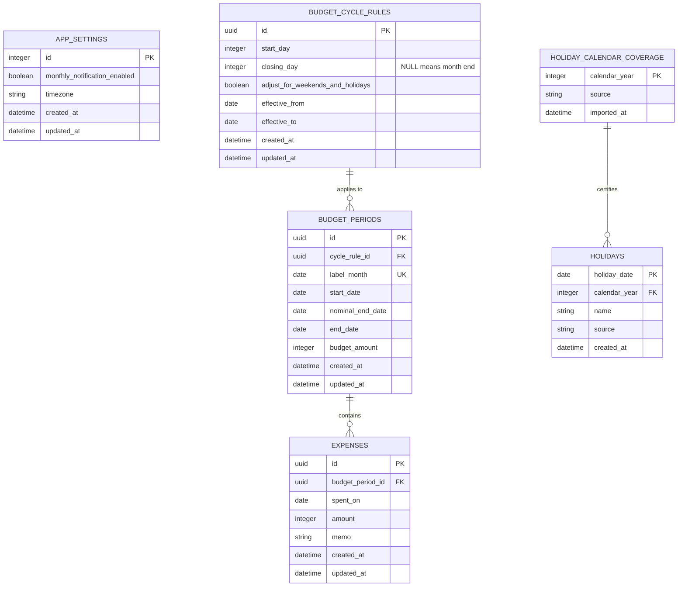

# ズボラ会計簿 データベース設計

## 1. 目的と方針

ズボラ会計簿は、アカウントを作らずスマートフォン内で完結するアプリです。本番は端末内 SQLite、開発と将来のクラウド移行確認には PostgreSQL を使用します。

- データの所有者は端末内の1利用者のみとし、現時点ではユーザーテーブルを持ちません。
- 金額は日本円の整数で保存します。
- UUIDと日時はJavaScriptで生成し、DB固有の生成関数には依存しません。
- 日付は `YYYY-MM-DD`、日時はUTCのISO 8601を共通表現とします。
- PostgreSQL固有のENUM、配列、JSON、排他制約、更新トリガーは使用しません。
- 複数行を変更する処理と期間重複検証は、Repositoryのトランザクション内で行います。

## 2. ER図

`budget_period_summary` は `budget_periods` と `expenses` を集計するビューです。

## 3. テーブル定義

### app_settings

アプリ全体の設定を1行だけ保持します。`id = 1` をDB制約で固定します。初回起動時にアプリが通知ON、タイムゾーン `Asia/Tokyo` で作成します。

### budget_cycle_rules

やりくり期間の設定履歴です。設定変更時は現在のルールを次期間開始日の前日で終了させ、次期間開始日から有効な新しい行を作成します。

- `start_day`: 1〜28
- `closing_day`: 1〜28。月末はNULL
- `effective_to`: NULLなら現在または将来まで有効
- 有効期間の重複はRepositoryのトランザクション内で検証

### budget_periods

実際に使用する予算期間です。ルールを参照しつつ、開始日と締め日をスナップショットとして保持するため、後から設定を変更しても過去の表示は変わりません。

- `label_month`: 締め日の属する月の1日。例：2026年9月分は `2026-09-01`
- `nominal_end_date`: 土日祝調整前の締め日
- `end_date`: 実際の締め日
- `budget_amount`: 1以上の日本円整数
- 次期間の初期金額は直前期間の `budget_amount` を引き継ぐ
- 進行中期間の金額変更は同じ行を更新する

### expenses

支出1件を表します。カテゴリは持ちません。空文字のメモはRepositoryでNULLへ正規化します。

- `amount`: 1以上
- `memo`: NULLまたは120文字以内
- `spent_on`: 所属期間の `start_date` 以上、`end_date` 以下
- 期間外日付の検証は、期間行を同じトランザクション内で読み込んで行う

### holiday_calendar_coverage / holidays

`holiday_calendar_coverage` は、ある年の祝日データが完全に取り込まれたことを示します。祝日が1件もない年と未取得の年を区別するために必要です。

自動調整を行う場合、対象年のcoverageがなければ期間を生成しません。`holidays` の年は `holiday_date` の年と一致させます。

## 4. 型対応

| 論理型 | SQLite | PostgreSQL | JavaScript |
| --- | --- | --- | --- |
| UUID | `TEXT` | `UUID` | string |
| 金額 | `INTEGER` | `BIGINT` | safe integer number |
| 日付 | `TEXT` | `DATE` | `YYYY-MM-DD` string |
| 日時 | `TEXT` | `TIMESTAMPTZ` | UTC ISO 8601 string |
| 真偽値 | `INTEGER` 0/1 | `BOOLEAN` | boolean |
| 任意メモ | `TEXT NULL` | `VARCHAR(120) NULL` | string \| null |

金額入力の上限は現在9桁のためJavaScriptの安全整数範囲内です。PostgreSQLの `BIGINT` はドライバーから文字列で返る場合があるため、Repository境界で安全整数を確認してnumberへ変換します。

## 5. 予算期間の生成規則

1. `label_month` の年月に `closing_day` を適用し、NULLなら月末を `nominal_end_date` とします。
2. `start_day <= nominal_end_dateの日` なら同じ月、それ以外は前月に開始日を置きます。
3. 自動調整ONの場合、対象年の祝日coverageを確認します。
4. 締め日が土日または祝日なら、平日かつ非祝日になるまで1日ずつ戻します。
5. 調整後締め日が開始日より前になる設定は拒否します。
6. 既存期間と日付範囲が重なる場合は、期間を作成しません。

期間計算は `backend/src/domain/budget-periods.js` を唯一の実装とし、DBごとに計算を分けません。

## 6. 集計

`budget_period_summary` は次を返します。

- `budget_amount`: 期間予算
- `spent_amount`: 支出合計
- `remaining_amount`: 予算額 − 支出合計。負数を許可
- `expense_count`: 支出件数

ホームの当日支出とカレンダーの日別支出は、`expenses.spent_on` で追加集計します。グラフは `label_month` の年で絞り、`remaining_amount` を月順に表示します。

## 7. Repository境界

スマホのSQLite実装と開発用PostgreSQL実装は、次の操作を同じ入出力で提供します。

- 現在の予算期間とサマリー取得
- 進行中期間の予算更新
- 支出の作成・編集
- 日付範囲または日単位の支出取得
- 年単位の残額一覧取得
- 設定取得・更新と次期間用ルール作成

SQLite接続時は毎回 `PRAGMA foreign_keys = ON` を実行します。複数行更新、ルール切替、次期間作成はトランザクションを必須とします。

## 8. マイグレーションと将来移行

- SQLiteとPostgreSQLは同じ番号のup/down SQLを持ちます。
- SQLiteのバージョンは `PRAGMA user_version` で管理します。
- UUIDを端末側で生成するため、クラウド移行時も主キーを維持できます。
- クラウド化時に所有者ID、同期状態、削除済み情報を追加します。現在のMVPには先行追加しません。
- SQLiteファイル、DB接続情報、実データはリポジトリへコミットしません。
