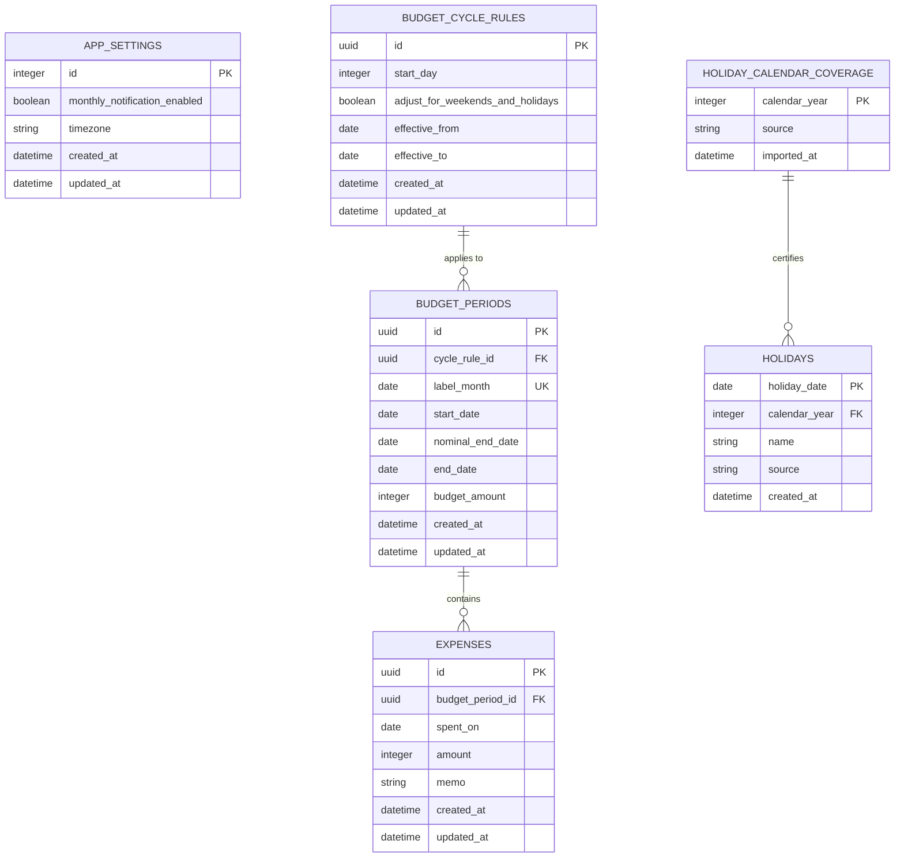

# ズボラ会計簿 データベース設計

## 1. 目的と方針

ズボラ会計簿は、アカウントを作らずスマートフォン内で完結するアプリです。今回の開発ではSpring BootからSQLiteを使用し、PostgreSQL接続は行いません。

- データの所有者は端末内の1利用者のみとし、現時点ではユーザーテーブルを持ちません。
- 金額は日本円の整数で保存します。
- UUIDと日時はアプリケーション層で生成し、DB固有の生成関数には依存しません。
- 日付は `YYYY-MM-DD`、日時はUTCのISO 8601を共通表現とします。
- 複数行を変更する処理と期間重複検証は、Repositoryのトランザクション内で行います。

## 2. ER図

`budget_period_summary` は `budget_periods` と `expenses` を集計するビューです。

## 3. テーブル定義

### app_settings

アプリ全体の設定を1行だけ保持します。`id = 1` をDB制約で固定します。初回起動時にアプリが通知ON、タイムゾーン `Asia/Tokyo` で作成します。

### budget_cycle_rules

やりくり期間の設定履歴です。設定変更時は現在のルールを次期間開始日の前日で終了させ、次期間開始日から有効な新しい行を作成します。

- `start_day`: 1〜31。存在しない日付は月末へ丸める
- `effective_to`: NULLなら現在または将来まで有効
- 有効期間の重複はRepositoryのトランザクション内で検証

### budget_periods

実際に使用する月度の期間です。ルールを参照しつつ、開始日と終了日をスナップショットとして保持するため、後から設定を変更しても過去の表示は変わりません。

- `label_month`: 月度の開始月の1日。例：2026年9月度は `2026-09-01`
- `start_date`: `label_month` の `start_day` 日を月末へ丸めた後、土日祝調整ONなら直前の平日へ調整した日
- `nominal_end_date`: 次月度の開始予定日の前日。次月度に新ルールを適用する場合は、その新ルールの `start_day` を翌月末へ丸めた日から求める
- `end_date`: 次月度の調整済み `start_date` の前日。隣接する月度との空白・重複を作らない
- `budget_amount`: 1以上の日本円整数
- 次期間の初期金額は直前期間の `budget_amount` を引き継ぐ
- 進行中期間の金額変更は同じ行を更新する

### expenses

支出1件を表します。カテゴリは持ちません。空文字のメモはRepositoryでNULLへ正規化します。

- `amount`: 1以上
- `memo`: NULLまたは120文字以内
- `spent_on`: 所属期間の `start_date` 以上、`end_date` 以下
- 期間外日付の検証は、期間行を同じトランザクション内で読み込んで行う

### holiday_calendar_coverage / holidays

`holiday_calendar_coverage` は、ある年の祝日データが完全に取り込まれたことを示します。祝日が1件もない年と未取得の年を区別するために必要です。

自動調整を行う場合、対象年のcoverageがなければ期間を生成しません。`holidays` の年は `holiday_date` の年と一致させます。

## 4. 型対応

| 論理型 | SQLite | Java |
| --- | --- | --- |
| UUID | `TEXT` | `UUID` |
| 金額 | `INTEGER` | `long` |
| 日付 | `TEXT` | `LocalDate` |
| 日時 | `TEXT` | `Instant` |
| 真偽値 | `INTEGER` 0/1 | `boolean` |
| 任意メモ | `TEXT NULL` | `String` または `null` |

`holidays.holiday_date` はSQLite上で `YYYY-MM-DD` 形式の `TEXT` 主キーです。Hibernateの識別子変換がSQLite向け `TEXT` 制約と一致しないため、`HolidayEntity`ではこの列のみ `String`（ISO日付）として保持し、期間計算側の `LocalDate` は `toString()` でDAOのIDに変換します。

金額入力の上限は現在9桁のためSQLiteの64bit整数とJavaの`long`の範囲内です。

## 5. 予算期間の生成規則

1. `start_day` は1〜31です。各月の開始予定日は `min(start_day, その月の末日)` とします。
2. 自動調整ONの場合、開始予定日の対象年の祝日coverageを確認し、土日または祝日なら平日かつ非祝日になるまで1日ずつ戻して `start_date` とします。
3. 次月度の開始予定日の前日を `nominal_end_date` とします。ルール変更時は次月度に適用する新ルールで計算し、進行中月度の `nominal_end_date` も更新します。
4. 次月度の調整済み `start_date` の前日を `end_date` とし、月度を連続させます。
5. 調整で終了日が開始日より前にならず、既存期間と日付範囲が重ならない場合のみ期間を作成します。

期間計算はSpring Bootの `BudgetPeriodService` に一元化します。既存の `backend/src/domain/budget-periods.js` は移植時の検証用参照とし、同じテストケースをJavaのServiceテストへ移します。

## 6. 集計

`budget_period_summary` は次を返します。

- `budget_amount`: 期間予算
- `spent_amount`: 支出合計
- `remaining_amount`: 予算額 − 支出合計。負数を許可
- `expense_count`: 支出件数

ホームの当日支出とカレンダーの日別支出は、`expenses.spent_on` で追加集計します。グラフは `label_month` の年で絞り、`remaining_amount` を月順に表示します。

## 7. Repository境界

Spring BootのSQLite DAOは、次の操作をServiceへ提供します。

- 現在の予算期間とサマリー取得
- 進行中期間の予算更新
- 支出の作成・編集
- 日付範囲または日単位の支出取得
- 年単位の残額一覧取得
- 設定取得・更新と次期間用ルール作成

SQLite接続時は毎回 `PRAGMA foreign_keys = ON` を実行します。複数行更新、ルール切替、次期間作成はトランザクションを必須とします。

## 8. マイグレーションと将来移行

- Spring Boot実行時はFlywayのバージョン付きSQL／Javaマイグレーションを適用し、`flyway_schema_history` をスキーマバージョンの正とします。
- 新規DBは、開始日1〜31日対応を含むFlywayのV1を適用します。旧Node.jsマイグレーション済みのDBは、1〜31日対応のスキーマを確認してからFlywayのV1へ引き継ぎます。
- 開始日が1〜28日の旧v1 DBは自動引き継ぎしません。バックアップ後に別途スキーマを1〜31日へ移行する必要があります。
- UUIDをアプリケーション側で生成するため、将来クラウドへ移行するときも主キーを維持できます。
- クラウド化時に所有者ID、同期状態、削除済み情報を追加します。現在のMVPには先行追加しません。
- SQLiteファイル、DB接続情報、実データはリポジトリへコミットしません。
