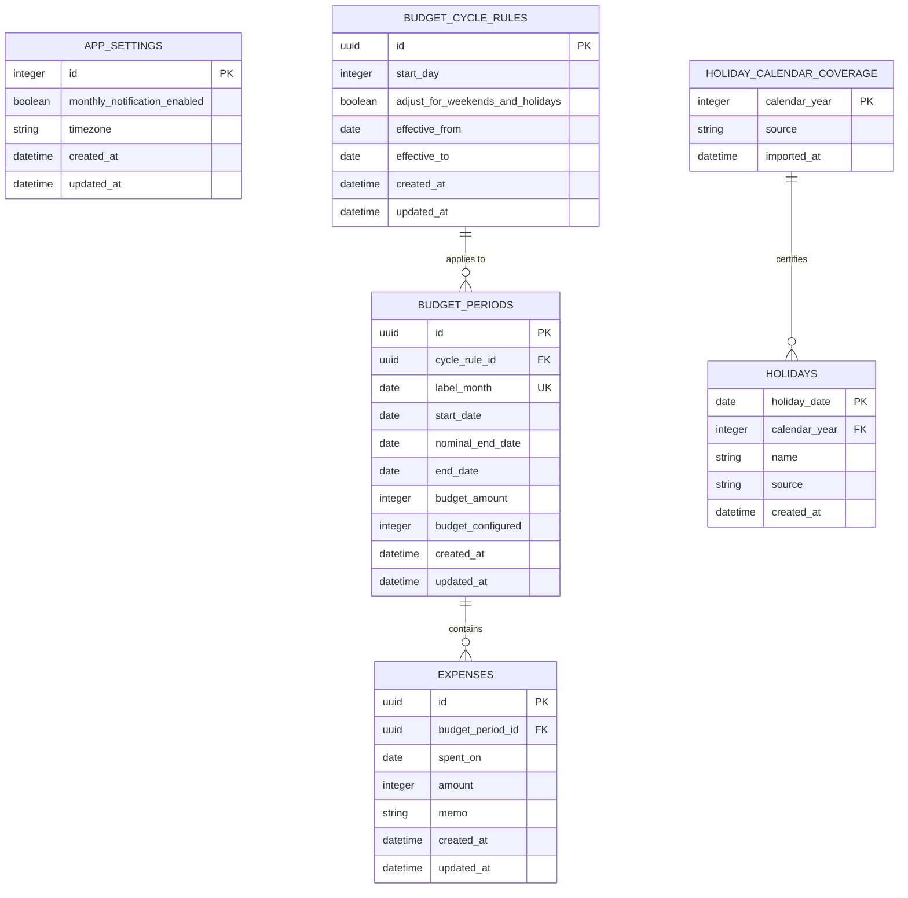

# ズボラ家計簿 データベース設計

## 1. 目的と方針

ズボラ家計簿は、アカウントを作らずスマートフォン内で完結するアプリです。今回の開発ではSpring BootからSQLiteを使用し、PostgreSQL接続は行いません。

- データの所有者は端末内の1利用者のみとし、現時点ではユーザーテーブルを持ちません。
- 金額は日本円の整数で保存します。
- UUIDと日時はアプリケーション層で生成し、DB固有の生成関数には依存しません。
- 日付は `YYYY-MM-DD`、日時はUTCのISO 8601を共通表現とします。
- 複数行を変更する処理と期間重複検証は、Repositoryのトランザクション内で行います。
- Expo版では`onboarding_state`の単一行で説明完了を管理します。初期設定済みかどうかの判定とは独立し、バックアップ対象の家計簿データには含めません。

## 2. ER図

`budget_period_summary` は `budget_periods` と `expenses` を集計するビューです。

## 3. テーブル定義

### app_settings

アプリ全体の設定を1行だけ保持します。`id = 1` をDB制約で固定します。初回起動時にアプリが通知ON、タイムゾーン `Asia/Tokyo` で作成します。

### budget_cycle_rules

やりくり期間の現行設定です。開始日・土日祝調整の変更時は全月度を同じルールで再計算し、参照を付け替えた後に旧ルール行を整理します。旧ルールを監査履歴として保持しません。

- `start_day`: 1〜31。存在しない日付は月末へ丸める
- `effective_to`: NULLなら現在または将来まで有効
- 有効期間の重複はRepositoryのトランザクション内で検証

### budget_periods

実際に使用する月度の期間です。ルールを参照しつつ、開始日と終了日をスナップショットとして保持します。開始日・土日祝調整の変更では保存済みの全月度のスナップショットを再計算します。各月度の予算額はラベル月に保持します。未作成の前後月度は表示・記録が必要になった時に予算0円で作成します。

- `label_month`: 月度の開始月の1日。例：2026年9月度は `2026-09-01`
- `start_date`: `label_month` の `start_day` 日を月末へ丸めた後、土日祝調整ONなら直前の平日へ調整した日
- `nominal_end_date`: 次月度の開始予定日の前日。次月度に新ルールを適用する場合は、その新ルールの `start_day` を翌月末へ丸めた日から求める
- `end_date`: 次月度の調整済み `start_date` の前日。隣接する月度との空白・重複を作らない
- `budget_amount`: 0以上の日本円整数
- `budget_configured`: 0または1。0は未設定、1はユーザーが金額を確定済みであることを表す。`budget_amount = 0`かつ設定済みの状態を許可する
- 初期設定時の当月度だけ入力額を保存する。前月度・次月度を新しく生成するときは前月度の金額を引き継がず、0から始める。予算更新は対象月度だけに反映する
- 進行中期間の金額変更は同じ行を更新する
- 期間の再計算後も予算額は月度ラベルに紐付けて保持する。支出は `spent_on` を変えず、新しい期間に合わせて `budget_period_id` のみ付け替える

### expenses

支出1件を表します。カテゴリは持ちません。空文字のメモはRepositoryでNULLへ正規化します。

- `amount`: 1以上
- `memo`: NULLまたは120文字以内
- `spent_on`: 所属期間の `start_date` 以上、`end_date` 以下
- 期間外日付の検証は、期間行を同じトランザクション内で読み込んで行う

### holiday_calendar_coverage / holidays

`holiday_calendar_coverage` は、ある年の祝日データが完全に取り込まれたことを示します。祝日が1件もない年と未取得の年を区別するために必要です。

自動調整を行う場合、2027年以前は対象年のcoverageがなければ期間を生成しません。モバイル版の2028年以降は未収録年を暫定的に土日のみ調整し、coverageがある年は祝日も使います。`holidays` の年は `holiday_date` の年と一致させます。

## 4. 型対応

| 論理型 | SQLite | Java |
| --- | --- | --- |
| UUID | `TEXT` | `UUID` |
| 金額 | `INTEGER` | `long` |
| 日付 | `TEXT` | `LocalDate` |
| 日時 | `TEXT` | `Instant` |
| 真偽値 | `INTEGER` 0/1 | `boolean` |
| 任意メモ | `TEXT NULL` | `String` または `null` |

`holidays.holiday_date` はSQLite上で `YYYY-MM-DD` 形式の `TEXT` 主キーです。Hibernateの識別子変換がSQLite向け `TEXT` 制約と一致しないため、`HolidayEntity`ではこの列のみ `String`（ISO日付）として保持し、期間計算側の `LocalDate` は `toString()` でDAOのIDに変換します。

金額入力の上限は現在9桁のためSQLiteの64bit整数とJavaの`long`の範囲内です。

## 5. 予算期間の生成規則

1. `start_day` は1〜31です。各月の開始予定日は `min(start_day, その月の末日)` とします。
2. 自動調整ONの場合、開始予定日の対象年の祝日coverageを確認し、土日または収録済みの祝日なら平日かつ非祝日になるまで1日ずつ戻して `start_date` とします。モバイル版の2028年以降の未収録年は土日のみ調整します。
3. 次月度の開始予定日の前日を `nominal_end_date` とします。ルール変更時は全月度とその次月度を同じ新ルールで計算し、保存済みの `nominal_end_date` を更新します。
4. 次月度の調整済み `start_date` の前日を `end_date` とし、月度を連続させます。
5. 調整で終了日が開始日より前にならず、既存期間と日付範囲が重ならない場合のみ期間を作成します。
6. 設定変更時は保存済みの全月度を同じ現行ルールで再計算します。10月7日に開始日を8日へ変更した例では、9月度は9月8日〜10月7日、8月度は8月8日〜9月7日です。境界をまたぐ支出は記録日により所属月度を更新し、集計ビューを再計算します。期間・ルール・支出の変更は単一トランザクションで行います。

Web版の期間計算はSpring Bootの `BudgetPeriodService`、オフラインのモバイル版は `mobile/src/domain/period.ts` に実装します。両者は同じ境界規則を使用します。既存の `backend/src/domain/budget-periods.js` は検証用参照です。

## 6. 集計

`budget_period_summary` は次を返します。

- `budget_amount`: 期間予算
- `spent_amount`: 支出合計
- `remaining_amount`: 予算額 − 支出合計。負数を許可
- `expense_count`: 支出件数

ホームの当日支出とカレンダーの日別支出は、`expenses.spent_on` で追加集計します。グラフは `label_month` の年で絞り、`remaining_amount` を月順に表示します。

## 7. Repository境界

Spring BootのSQLite DAOは、次の操作をServiceへ提供します。

- 現在の予算期間とサマリー取得
- 進行中期間の予算更新
- 支出の作成・編集
- 日付範囲または日単位の支出取得
- 年単位の残額一覧取得
- 設定取得・更新と保存済み全月度への現行ルール適用

SQLite接続時は毎回 `PRAGMA foreign_keys = ON` を実行します。複数行更新、ルール切替、月度境界と支出所属の更新はトランザクションを必須とします。

モバイル版の `LocalRepository` は同じテーブル・ビューへ直接アクセスし、初期設定、月度の繰り越し、支出、予算、設定、画面用集計を提供します。初期化時に内閣府公表の2025〜2027年の祝日・休日を年単位で端末DBへ登録します。2027年以前の未収録年では月度生成を停止します。2028年以降の未収録年は月度の利用を止めないため土日のみ暫定調整し、年全体の祝日データを登録した後に新たに計算する月度では祝日も反映します。既存の月度境界は自動で再計算しません。

## 8. マイグレーションと将来移行

- Spring Boot実行時はFlywayのバージョン付きSQL／Javaマイグレーションを適用し、`flyway_schema_history` をスキーマバージョンの正とします。
- モバイル版は `PRAGMA user_version` と `mobile/src/database/migrations.ts` で端末内DBを移行します。新規端末DBのV1はSpring Boot版V1と同じスキーマです。
- V2では `budget_periods.budget_amount` の制約を0以上に変更し、既存の自動生成月度を0へ戻します。支出レコードはトランザクション内で退避・復元します。旧DBには明示設定フラグがないため、初期設定月度と更新日時が異なる月度をユーザー設定済みとして保持します。
- V4では `budget_periods.budget_configured` を追加し、未設定の0円とユーザーが確定した0円を区別します。既存の正額予算は設定済みへ移行します。
- 新規DBは、開始日1〜31日対応を含むFlywayのV1を適用します。旧Node.jsマイグレーション済みのDBは、1〜31日対応のスキーマを確認してからFlywayのV1へ引き継ぎます。
- 開始日が1〜28日の旧v1 DBは自動引き継ぎしません。バックアップ後に別途スキーマを1〜31日へ移行する必要があります。
- UUIDをアプリケーション側で生成するため、将来クラウドへ移行するときも主キーを維持できます。
- クラウド化時に所有者ID、同期状態、削除済み情報を追加します。現在のMVPには先行追加しません。
- SQLiteファイル、DB接続情報、実データはリポジトリへコミットしません。
